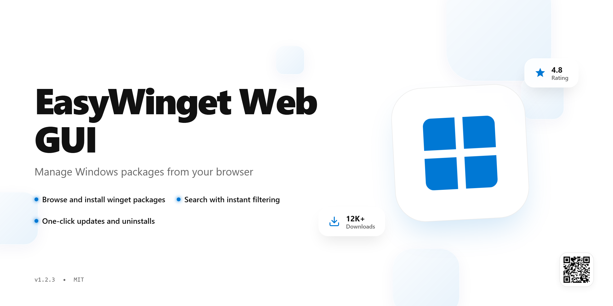

# EasyWinget — Modern Software Management Web App ✨

### ⚡ PowerShell Setup Button

   

---

EasyWinget Web GUI turns the Windows Package Manager into a clean, browser-based workspace where installing, updating, and organizing software feels effortless. Built with Node.js and Vanilla JS, it puts the full power of Winget behind a modern interface designed for clarity and speed. Search, deploy, and maintain your entire application lineup from one polished dashboard — no command line required. Whether you're setting up a fresh machine or keeping an existing one in shape, EasyWinget makes package management genuinely approachable.

## ✅ Before You Start

- Windows 10 or Windows 11
- PowerShell 5.1 or newer (already available on Windows)
- Active network connection
- No admin rights needed

## Features

**A polished desktop-grade interface for the Windows Package Manager.** EasyWinget replaces command-line friction with a clean, responsive Web GUI you can open in any browser — search, install, update, and remove software without ever touching a terminal.

- **🔎 Unified package search** — Explore the full WinGet catalog through a single, fast search field with instant results, category filtering, and clear package details at a glance.
- **📥 One-click installs** — Browse, select, and install any available package through a guided flow with live progress feedback, so you always know exactly what is happening.
- **🔄 Update center** — See every outdated application in one organized view, compare installed and available versions side by side, and refresh packages individually or in batches.
- **🗂️ Installed software management** — Review everything currently on your machine in a tidy list, with quick removal actions and status indicators for each entry.
- **⚡ Lightweight by design** — Built on Node.js with a Vanilla JS frontend, keeping the footprint small, startup quick, and the experience snappy on modest hardware.
- **🌐 Zero-install access** — Runs as a local web application, so you can use it from any modern browser on your machine with no separate client software to maintain.
- **🎨 Clean, modern interface** — A distraction-free layout with thoughtful spacing, readable typography, and responsive behavior that feels at home on any screen size.
- **🔒 Local-first operation** — All package operations run against the Windows Package Manager on your own system; nothing about your software inventory leaves your machine.
- **🛠️ Transparent and approachable** — An open, readable codebase that welcomes exploration, so you can understand exactly how each action maps to WinGet commands.

EasyWinget brings the power of a package manager into a familiar, friendly window — software management that feels less like administration and more like a well-designed product.

## Tech Stack

Under the hood, EasyWinget Web GUI pairs a lean **Node.js** runtime with a **Vanilla JS** front end—no heavyweight frameworks, no build-time bloat, just fast, dependable performance that keeps the interface crisp and responsive. The architecture is intentionally transparent: every layer is lightweight, purpose-built, and easy to extend, so the experience stays smooth whether you're installing a single utility or managing a full software library.

- **Node.js backend** — a streamlined server layer that brokers every interaction with the Windows Package Manager, keeping operations organized and the UI responsive.
- **Vanilla JS interface** — a clean, dependency-light front end that loads instantly and renders the full package catalog with fluid, modern interactions.
- **Direct Winget integration** — commands are dispatched straight to the native Windows Package Manager, so installation, updates, and removal happen exactly where they should: on your machine.
- **Lightweight by design** — no sprawling framework overhead, no unnecessary abstractions; the stack stays small so the app stays quick.
- **Accessible foundation** — the entire stack is openly available and community-friendly, giving every user the same seamless experience.

The result is a stack that feels effortless from the first click—modern, polished, and engineered to let the product, not the plumbing, take center stage.

## FAQ

**Is EasyWinget Web GUI really no-cost to use?**
Absolutely. EasyWinget Web GUI is fully accessible at no cost — every feature, from package discovery to the updates center, is available to everyone without a paywall or license key. It's built on open foundations and shared with the community.

**Do I need to be a command-line expert to use it?**
Not at all. EasyWinget Web GUI was designed precisely to remove that barrier. The entire Windows Package Manager workflow — searching, installing, updating, and removing software — is handled through a clean, modern web interface. If you can click, you can manage your packages.

**Does it work alongside the standard winget CLI?**
Yes. EasyWinget Web GUI operates on top of the official Windows Package Manager, so anything you install or update through the interface stays fully consistent with the underlying CLI. You can switch between both approaches whenever you like.

**Which platforms are supported?**
EasyWinget Web GUI targets Windows systems with the Windows Package Manager available. The interface runs in your browser through a lightweight Node.js backend, so no heavyweight desktop runtime is required.

**Is my data safe?**
All package operations happen locally on your machine against the official Windows Package Manager. EasyWinget Web GUI doesn't ship your information off to third parties, and the codebase is open for inspection so you can verify exactly what it does.

**How do I stay current with new releases?**
Watch the repository's releases to be notified of improvements, new interface capabilities, and refinements. Updates are published regularly, and each release is accompanied by clear notes describing what changed.

**Can I tailor it to my workflow?**
Yes — the project is built with vanilla JavaScript and a Node.js backend, making it straightforward to extend, restyle, or integrate into your own tooling. Contributions and feature suggestions from the community are always welcome.

**Something isn't behaving as expected — where do I turn?**
Open an issue on the project's tracker with a description of what you encountered. Bug reports and feedback directly shape the roadmap, and the maintainers review them regularly.

## License

EasyWinget Web GUI is released under the MIT License, giving you the widest possible room to make it your own. You may use, copy, modify, merge, publish, distribute, sublicense, and sell copies of the software, provided the original copyright notice and permission notice travel with it.

In plain terms: tinker with the interface, adapt it to your workflow, fold it into internal tooling, or ship it as part of a larger product — all without asking permission or paying a fee. The only condition is keeping the license text intact in any substantial copy or derivative.

The software is provided "as is," without warranty of any kind, express or implied. The authors and copyright holders accept no liability for claims, damages, or other obligations arising from its use. Full license text is included in the repository for complete terms.